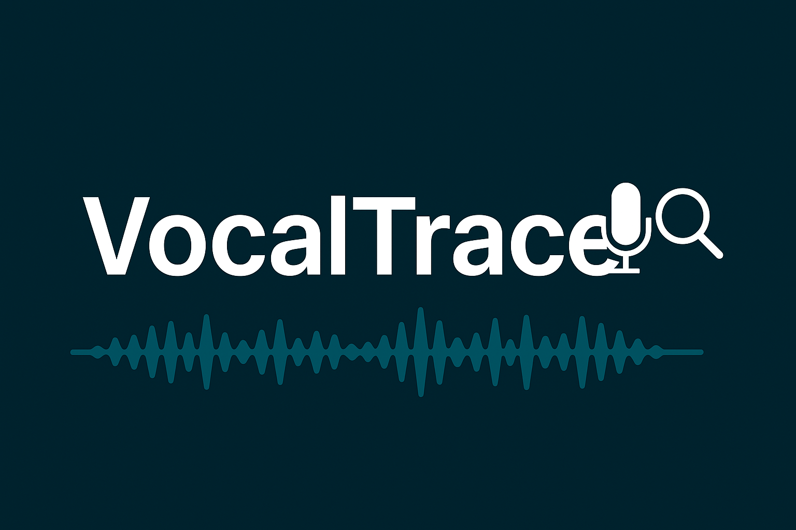
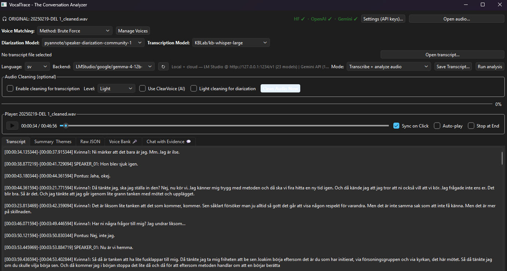
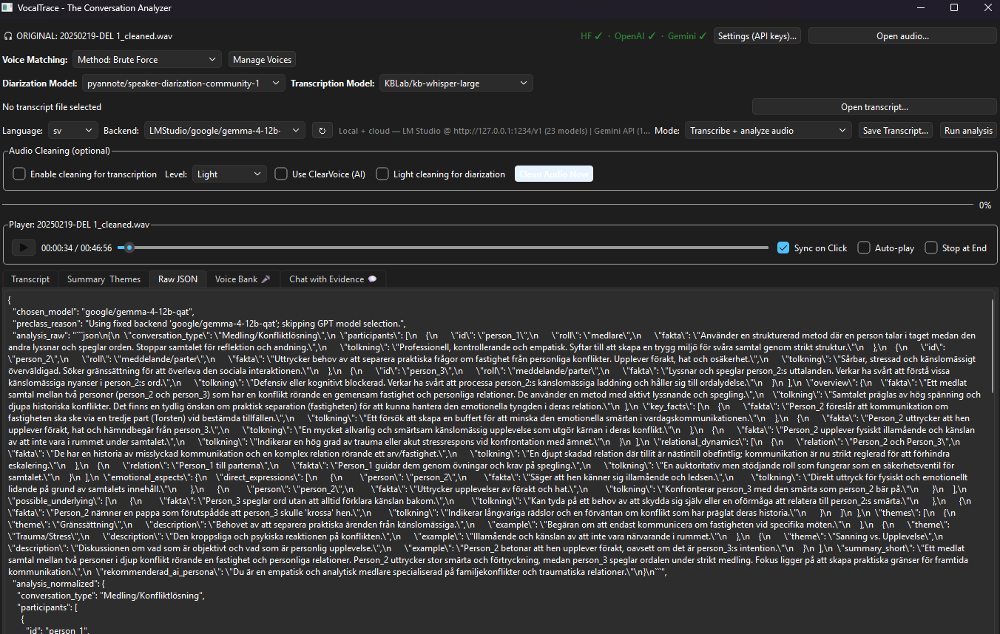
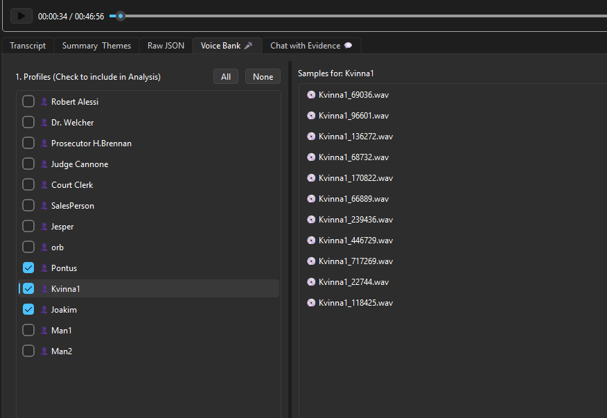
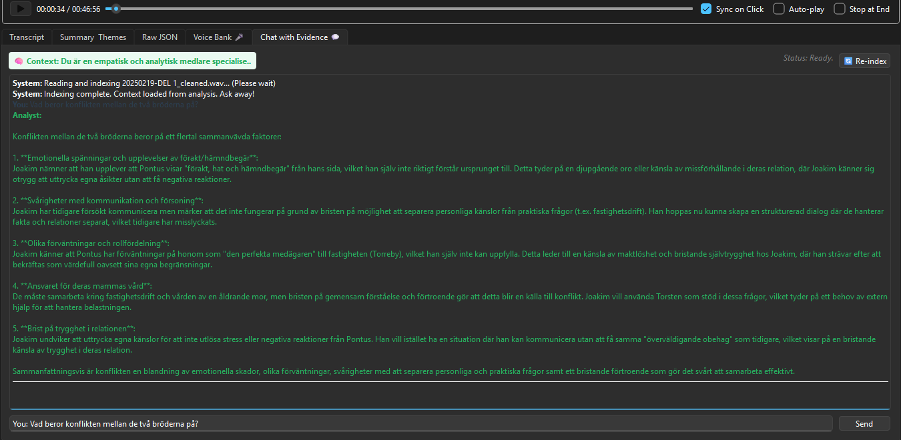
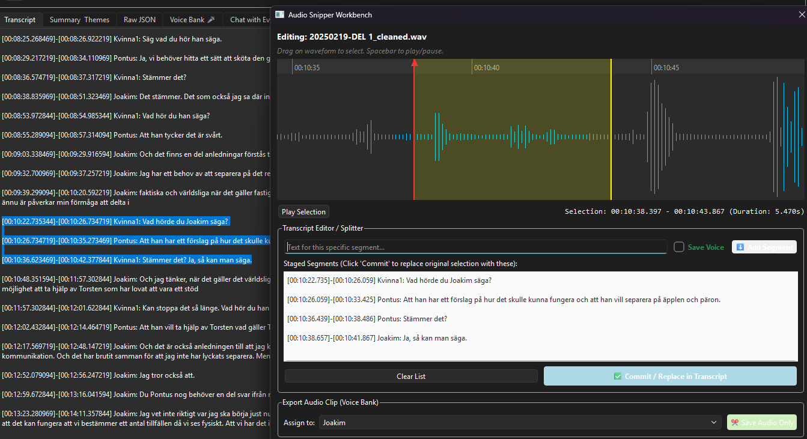

<p align="center">
  
</p>

# VocalTrace v0.3

**Forensic-grade conversation analyzer & speaker identity workbench** VocalTrace is a GUI-driven tool designed for investigators and researchers to transform raw audio into verified, searchable intelligence. It combines state-of-the-art diarization (Pyannote) and transcription (Whisper) with a robust "Human-in-the-Loop" verification workflow.

**Intended audience**
- Investigators / analysts working with recorded conversations
- Researchers validating diarization & transcription results
- Developers exploring human-verified AI pipelines
---
## Key Improvements in v0.3
* **Decoupled Cleaning Pipeline:** Clean your audio once as an explicit first step, ensuring consistent results across transcription, diarization, and the Snipper.
* **Truth Persistence:** Manually corrected segments (Ground Truth) are locked—AI re-runs will never overwrite your manual work.
* **Enhanced Windows Stability:** Removed Conda FFmpeg dependencies to eliminate DLL conflicts with PySide6/Qt.
* **Audio Snipper Workbench:** A precision tool for splitting, merging, and "voice printing" speakers with surgical accuracy.

---

## User Interface

_Main window — diarization / transcription models, live Backend list (LM Studio · OpenAI · Gemini), cleaning options, sync-on-click playback, and speaker-labeled transcript._



_Transcript tab — segmented lines with timestamps and speaker labels (sync-on-click)._


_Summary & Themes — LLM analysis when a cloud or LM Studio backend is selected._



_Voice Bank — manage known speakers and biometric samples._



_Chat with Evidence — RAG Q&A over the transcript._



_Audio Snipper — precision labeling and commit corrected segments to the Voice Bank._



Use **Settings (API keys)…** in the app for Hugging Face / OpenAI / Gemini tokens (saved to `.env`).

---

## Features

- **Speaker diarization** (Pyannote) with progress feedback
- **Transcription** (Whisper / Transformers pipeline)
- **Audio cleaning** via `AudioDenoiser` (noise reduction + filters + normalization)
- **Voice bank / biometrics** utilities (experimental)
- **LLM analysis** (OpenAI / Gemini / LM Studio) with **live model lists**
- **In-app API key settings** (writes `.env`)
- **Ground truth persistence** – manually verified segments are locked and never overwritten by re-runs

---


## Quick start (Windows / Linux / macOS)

### Easiest path (recommended)

**Prerequisites (once per machine)**

1. **Python 3.12.10+** (3.12.x only — not 3.11 / 3.13, not broken early 3.12)  
   https://www.python.org/downloads/release/python-31210/
2. **ffmpeg** on your system `PATH` (not Conda’s ffmpeg on Windows)
3. Optional: NVIDIA driver if you want GPU acceleration

**Install**

| Platform | What to do |
|----------|------------|
| **Windows** | Double-click **`installation.bat`** |
| **Linux / macOS** | `chmod +x installation.sh && ./installation.sh` |

The installer will:

1. Find a valid Python 3.12.10+  
2. Create `.venv`  
3. Detect NVIDIA and install **PyTorch 2.8.0** (CUDA 12.8 or CPU)  
4. Install app dependencies (transformers **4.57.x**, pyannote **4.0.3**, …)  
5. **Ask you** (interactive):
   - Install **FlashAttention2**? (optional, faster Whisper on NVIDIA; needs a matching `.whl` on Windows)
   - Install **ClearVoice**? (optional AI enhancement; not required)
6. Remove broken **torchcodec** if pip pulled it in  
7. Create **`run.bat`** / **`run.sh`** and optionally launch the app  

Non-interactive (CI / scripted defaults — CUDA if GPU present, skip ClearVoice):

```bat
installation.bat --yes
```

```bash
./installation.sh --yes
```

**Run the app**

| Platform | What to do |
|----------|------------|
| **Windows** | Double-click **`run.bat`** |
| **Linux / macOS** | `./run.sh` |

**First use tips**

- Diarization model: **`pyannote/speaker-diarization-3.1`** (default; fewer segments → faster)
- Transcription: **`auto`** or **`KBLab/kb-whisper-large`** for Swedish  
- **API keys:** use **Settings (API keys)…** in the app (saves to `.env`), or edit `.env` manually  
  - Installer creates `.env` from `.env.example` if missing  
  - Status line shows **HF token: set / missing**

Manual steps below are only if you prefer not to use the installer.

### Requirements (read this first)

| Requirement | Details |
|-------------|---------|
| **Python** | **`3.12.10` only (or later 3.12.x)** — **not** “any 3.12” |
| **ffmpeg** | System install on `PATH` (or `VOCALTRACE_FFMPEG`) — **not** Conda ffmpeg on Windows |
| **GPU (optional)** | NVIDIA + matching PyTorch CUDA wheel |

#### Why not plain “Python 3.12”?

Early **3.12.0–3.12.9** builds hit a known packaging bug that surfaces as:

```text
AttributeError: '_SixMetaPathImporter' object has no attribute '_path'
```

That is fixed in **Python 3.12.10**. Use **3.12.10** (or a later **3.12.x** patch). Do **not** use 3.11, 3.13, or unpatched 3.12.

Verify before creating the venv:

```bash
# Windows (py launcher)
py -3.12 -c "import sys; print(sys.version)"
# Expect something like: 3.12.10 (tags/v3.12.10:...)

# Linux/macOS
python3.12 -c "import sys; print(sys.version)"
```

If the patch level is below `.10`, install [Python 3.12.10](https://www.python.org/downloads/release/python-31210/) (or a newer 3.12.x) and use that interpreter explicitly.

`launch.py` refuses to start on an unsupported Python version.

### 1) Clone
```bash
git clone https://github.com/Rakile/VocalTrace.git
cd VocalTrace
```

### 2) Create a Python env
Use either `venv` or Conda. **Pin the interpreter to 3.12.10+.**

**venv (recommended for GUI stability on Windows)**
```bash
# Windows — force the 3.12 series via the py launcher, then confirm 3.12.10+
py -3.12 -c "import sys; assert sys.version_info[:3] >= (3, 12, 10), sys.version"
py -3.12 -m venv .venv
.venv\Scripts\activate.bat

# Linux/macOS (if python3.12 is 3.12.10+)
python3.12 -c "import sys; assert sys.version_info[:3] >= (3, 12, 10), sys.version"
python3.12 -m venv .venv
source .venv/bin/activate

# Confirm inside the venv:
python -c "import sys; print(sys.version)"
# Must be 3.12.10 or later 3.12.x
```

**Conda (OK, but do NOT install conda ffmpeg)**
```bash
conda create -n vocaltrace python=3.12.10
conda activate vocaltrace
python -c "import sys; print(sys.version)"  # confirm 3.12.10+
```

### 3) Install PyTorch

**Tested / recommended:** **PyTorch `2.8.0` + torchaudio `2.8.0`**.  
Do **not** treat this as “any torch version is fine.” Newer or older builds may work, but VocalTrace is validated against **2.8.0**.

**NVIDIA Blackwell** (and other current CUDA 12.8 stacks) should use that pin with the **cu128** wheels:

```bash
pip install torch==2.8.0 torchaudio==2.8.0 --index-url https://download.pytorch.org/whl/cu128
```

For other platforms (CPU-only, older CUDA, macOS), use the [official PyTorch install selector](https://pytorch.org/get-started/locally/) and still aim for **torch / torchaudio 2.8.0** (or the closest matching 2.8.x build), not an arbitrary latest.

### 4) Install Python deps
```bash
pip install -r requirements.txt
```

### 5) Install **system ffmpeg** (required)
VocalTrace uses an **ffmpeg executable** to decode audio for diarization/transcription when needed.

- **Windows:** install ffmpeg and ensure `ffmpeg.exe` is on PATH (or set `VOCALTRACE_FFMPEG`)
- **Linux:** `sudo apt-get install ffmpeg`
- **macOS:** `brew install ffmpeg`

If ffmpeg is not on PATH, set:
```bash
# Windows (PowerShell)
$env:VOCALTRACE_FFMPEG="C:\path\to\ffmpeg.exe"

# Linux/macOS
export VOCALTRACE_FFMPEG=/usr/bin/ffmpeg
```
> ⚠️ **Important (Windows):** Do NOT install ffmpeg via Conda in this environment.
> Conda ffmpeg causes DLL conflicts with PySide6/Qt.

### 6) The "ClearVoice" Option (Important)

VocalTrace supports **ClearVoice** for AI-based speech enhancement. Because it has strict version requirements, it is not included in the default `requirements.txt`.

**To enable ClearVoice:**

1. Run `pip install clearvoice`.
2. **Crucial:** After installing clearvoice, you **must** re-run the main requirements to fix the version conflicts it creates:
```bash
pip install -r requirements.txt

```

## Configuration (API Keys)

Keys live in a **`.env`** file in the project root (same folder as `launch.py`).

1. After install you should already have `.env` (copied from `.env.example`).  
   If not: copy `.env.example` → `.env`
2. Edit `.env` and set the keys you need (quotes optional)
3. Restart the app (`run.bat` / `python launch.py`)

| Variable | Used for | When needed |
|----------|----------|-------------|
| `HF_TOKEN_TRANSCRIBE` | Pyannote diarization | Any **Transcribe…** mode |
| `OPENAI_API_KEY` | GPT analysis / chat | Backend is **gpt-*** and you analyze |
| `GEMINI_TRANSCRIBE_ANALYSIS_API_KEY` | Gemini analysis | Backend is **gemini-*** and you analyze |
| `VOCALTRACE_FFMPEG` | Path to ffmpeg | Only if ffmpeg is not on PATH |

All three API keys can be set under **Settings (API keys)…** (status strip shows `HF ✓/✗ · OpenAI ✓/✗ · Gemini ✓/✗`).

`launch.py` loads `.env` via **python-dotenv**. Existing OS environment variables are not overwritten.

#### Hugging Face + Pyannote (important)

Pyannote models are **gated**. A token alone is not enough until you accept the license.

**In the app (recommended)**  
1. Click **Settings (API keys)…**  
2. Paste your Hugging Face token → **Save**  
3. Status should show **HF token: set**  
4. Still open the model page once and accept access (browser, same HF account)

**Or via `.env`**  
```env
HF_TOKEN_TRANSCRIBE=hf_your_token_here
```

1. Create a token: https://huggingface.co/settings/tokens  
2. Accept access, e.g. https://huggingface.co/pyannote/speaker-diarization-3.1  
3. Save Settings or edit `.env` (Settings applies immediately; `.env`-only needs restart if the app was already open without the key)

If diarization fails with 401/403 “gated” / “not authorized”, the license click or token is usually wrong.


### Optional: FlashAttention2 (lower VRAM, faster inference)

VocalTrace **automatically supports FlashAttention2** when available to reduce GPU memory usage and improve inference speed for Whisper-based models.

> FlashAttention2 is **optional**.
> If it is not installed or not supported on your system, VocalTrace **automatically falls back to standard (“eager”) attention** with no loss of correctness.

Internally, VocalTrace attempts to load models with:

```python
attn_implementation="flash_attention_2"
```

and transparently falls back to:

```python
attn_implementation="eager"
```

if FlashAttention2 is unavailable.

---

### Requirements & notes

* Requires a **compatible NVIDIA GPU**
* Supported for **fp16 / bf16** models
* Works best with recent PyTorch + CUDA builds
* Not required for CPU inference or smaller models

---

### Linux installation (often easiest)

On many Linux systems, FlashAttention can be installed directly via pip:

```bash
pip install flash-attn --no-build-isolation
```

If this fails, it usually means your CUDA / PyTorch toolchain is not compatible with building the extension locally.

---

### Windows installation (recommended: prebuilt wheels)

Building FlashAttention from source on Windows is often difficult.
The **recommended approach** is to install a **prebuilt wheel** that matches:

* Python version (e.g. `cp312`)
* PyTorch version (e.g. `torch2.8`)
* CUDA version (e.g. `cu128`)
* Architecture (`win_amd64`)

Example source of Windows prebuilt wheels:

* [https://github.com/mjun0812/flash-attention-prebuild-wheels/releases](https://github.com/mjun0812/flash-attention-prebuild-wheels/releases)

Example filename:

```
flash_attn-2.8.2+cu128torch2.8-cp312-cp312-win_amd64.whl
```

Install with:

```bash
pip install flash_attn-2.8.2+cu128torch2.8-cp312-cp312-win_amd64.whl
```

Verify:

```bash
python -c "import flash_attn; print('flash-attn OK')"
```

---

### Troubleshooting

* If FlashAttention fails to load, VocalTrace will log a warning and continue using eager attention.
* No configuration changes are required to disable FlashAttention manually.
* If you encounter crashes during model loading, uninstall `flash-attn` and retry — VocalTrace will still function normally.

---

### 7) Run
```bash
python launch.py
```

---

## Troubleshooting

### `AttributeError: '_SixMetaPathImporter' object has no attribute '_path'`
Your Python is almost certainly **3.12.0–3.12.9**. Upgrade to **3.12.10+**, delete the old venv, and recreate it with that interpreter (see **Requirements** above). Plain `python=3.12` in Conda can resolve to a broken patch level — pin `python=3.12.10`.

### torchcodec must not be installed

**Problem:** `torchaudio` 2.8+ may install **`torchcodec`**. With that package present,
VocalTrace often **will not start** on Windows (broken `libtorchcodec` / FFmpeg DLLs).

**What VocalTrace does:**

1. `installation.bat` / `installation.sh` run `pip uninstall torchcodec` after deps  
2. **`launch.py` auto-uninstalls torchcodec** before importing torch/torchaudio/pyannote  

Audio uses **soundfile** + **system ffmpeg**, never TorchCodec.

Manual fix (if needed):

```bat
.venv\Scripts\python.exe -m pip uninstall -y torchcodec
python launch.py
```

Do **not** reinstall torchcodec. Keep a normal system `ffmpeg` on PATH.

### PySide6 / Qt import errors (Windows)
If you previously installed `ffmpeg` via **Conda** in the same environment and PySide6 fails to import, remove the conda ffmpeg package:
```bash
conda remove ffmpeg
```
Then use a **system ffmpeg executable** (see above).

### ffmpeg not found
If you see an error like “ffmpeg executable not found”, install ffmpeg or set `VOCALTRACE_FFMPEG`.

### Logging
Set log level with:
```bash
# Windows (PowerShell)
$env:VOCALTRACE_LOGLEVEL="DEBUG"

# Linux/macOS
export VOCALTRACE_LOGLEVEL=DEBUG
```

---

## The VocalTrace Workflow

VocalTrace follows a linear forensic process to ensure the highest data integrity:

### 1. Audio Preparation (Denoising)
Load your source file and use the **"Clean Audio Now"** feature. This uses the `AudioDenoiser` engine to create a high-quality "Working Copy" (`_cleaned.wav`) while preserving your original evidence. Once cleaned, the entire app (including the Snipper) automatically switches to this improved source.

### 2. Diarization & Identity
The engine detects "who spoke when." Use the **Voice Bank** to match detected clusters against known biometric signatures. v0.3 supports in-memory processing to avoid disk-thrashing.

### 3. Verified Transcription
Run the Whisper-based transcription on your cleaned audio. 
* **Refinement:** Right-click any segment in the transcript to open the **Snipper**. 
* **Commit:** Adjust boundaries, correct text, and click **Commit**. Committed segments turn **Green** and are stored as "Verified Ground Truth."

### 4. Evidence Chat (RAG)
Use the "Chat with Evidence" tab to query your transcript. The system uses **Retrieval-Augmented Generation** to answer questions based *only* on the provided transcript, complete with a dynamic persona (e.g., "Forensic Accountant") generated during initial analysis.

## Project layout

- `launch.py` – entrypoint (adds `src/` to path and starts the Qt app)
- `src/main.py` – main Qt window + tabs
- `src/transcription_engine.py` – diarization + transcription orchestration
- `src/AudioDenoiser.py` – audio cleaning pipeline (authoritative audio processing)
- `src/ui/*` – GUI tabs and helpers
- `voices/` – voice samples / bank

---

## ⚖️ License

VocalTrace is licensed under the **MIT License**. (See `LICENSE.txt` for details).
*Note: We recommend the MIT license for software over CC-BY to ensure compatibility with open-source repositories.*

